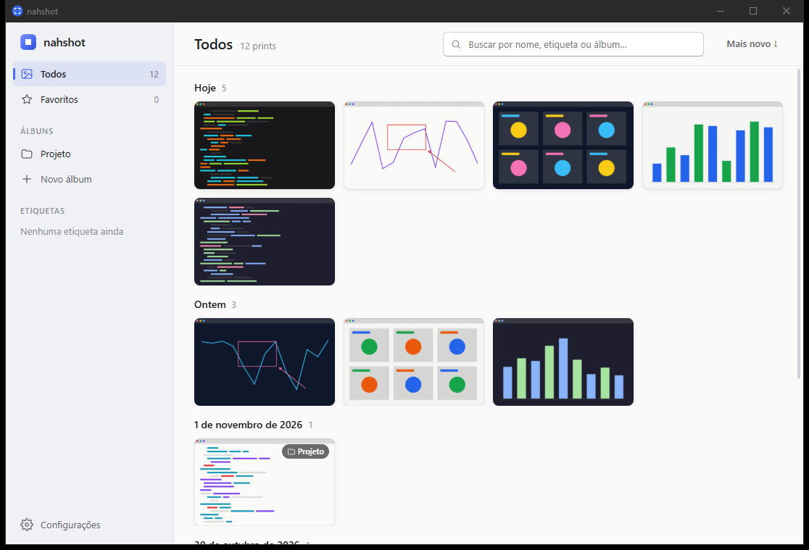

# nahshot

> A lightweight Lightshot-style screenshot tool for Windows, where every capture lands in an organized gallery. Rust + Tauri v2.

O nahshot é um app de captura de tela para Windows no estilo do Lightshot: você aperta Print Screen, seleciona uma área, anota e copia ou salva. A diferença é que **nenhum print se perde**. Toda captura confirmada vai, como PNG normal, para uma pasta organizada por mês e aparece numa galeria onde dá para navegar por data, buscar e organizar com álbuns, etiquetas e favoritos. Organizar é opcional: sem mexer em nada, tudo continua acessível por data. E ele tem que ser leve, senão a gente volta pro Lightshot. Por isso o overlay de captura é nativo e a galeria só existe enquanto está aberta.



## Recursos

**Captura**
- Print Screen (opcional: o nahshot assume a tecla e bloqueia a Ferramenta de Captura) ou um atalho alternativo (padrão `Ctrl+Shift+S`, configurável), além do menu da bandeja.
- A tela congela e escurece em **todos os monitores**. A seleção pode atravessar monitores com escalas de DPI diferentes, e a imagem salva fica em pixels físicos.
- Seleção com tamanho em pixels, ajustável (mover/redimensionar) antes de confirmar.
- Anotações: caneta livre, linha, seta, retângulo, elipse, marca-texto e texto, com seletor de cor e desfazer (`Ctrl+Z`).
- Copiar (`Ctrl+C`), Salvar como… (`Ctrl+S`) e Fechar (`Esc`). Qualquer captura com área selecionada é salva na galeria, mesmo se você só copiar ou fechar.

**Galeria**
- Grade de miniaturas agrupada por dia (Hoje, Ontem, datas), do mais novo pro mais velho, com opção de inverter.
- Busca por nome, etiqueta ou álbum.
- Álbuns (que são pastas de verdade no disco), etiquetas e favoritos.
- Visualizador com copiar, abrir no Explorer, renomear (renomeia o arquivo), favoritar, mover para álbum, etiquetar e apagar (vai para a Lixeira).
- Seleção múltipla (`Ctrl`/`Shift`+clique) e arrastar para um álbum.
- A pasta é a fonte da verdade: um PNG adicionado ou apagado pelo Explorer aparece ou some da galeria sozinho.

**App**
- Fica na bandeja, inicia com o Windows (configurável) e roda em instância única.
- Configurações: pasta dos prints (com opção de mover os existentes), iniciar com o Windows, Print Screen padrão, atalho e tema claro/escuro.
- 100% local, sem rede, sem precisar de administrador.

## Arquitetura

Um workspace Cargo com três crates:

| Crate | Papel |
|---|---|
| `crates/nahshot-core` | Domínio, sem UI: nomes de arquivo, biblioteca de prints (PNG + SQLite com `rusqlite`), álbuns como pastas, sincronização com a pasta, file watcher (`notify`), cache de miniaturas e realocação da pasta dos prints. |
| `crates/nahshot-capture` | Captura nativa: grava os monitores (`xcap`), desenha o overlay de seleção e anotação (`winit` + `softbuffer` + `tiny-skia`, texto com `fontdue`), atalho global e hook de teclado de baixo nível para o Print Screen. |
| `src-tauri` (pacote `nahshot`) | O app Tauri v2: bandeja, configurações, fluxo de captura (PNG → biblioteca → área de transferência / Salvar como), comandos da galeria e janelas. |

A UI da galeria, das configurações e da tela de boas-vindas fica em `ui/` (TypeScript puro + Vite, sem framework).

**Por que o overlay é nativo?** A meta é o overlay aparecer em menos de ~150 ms depois do Print Screen e o app ocupar menos de ~30 MB parado. Subir um WebView2 a cada captura é lento demais, e deixar um pré-aquecido custaria ~170 MB de RAM o tempo todo (é o que a galeria aberta consome, somando os processos do WebView2). Então o overlay é uma janela `winit` por monitor que pinta direto num buffer de software com `tiny-skia`, numa thread própria que também atende o hook de teclado. O WebView2 só existe enquanto a galeria (ou as configurações) estiver aberta. Fechou a janela, os processos do WebView2 encerram e o app volta para o consumo de bandeja.

## Leveza medida

Medido no build de release (`target\release\nahshot.exe`, gerado por `npm --prefix ui run tauri build`; o mesmo binário que o instalador NSIS empacota, rodado sem instalar), Windows 10 Pro com dois monitores 1920×1080, em 2026-11-04. A memória é a soma do processo `nahshot` **e de todos os descendentes** (WebView2 incluído), medida com [`scripts/measure-idle.ps1`](scripts/measure-idle.ps1).

| Estado | Private bytes | Working set | Processos |
|---|---|---|---|
| Parado na bandeja, 60 s após o boot | **23.2 MB** | 33.4 MB | 1 |
| Depois de 5 capturas | 24.2 MB | 37.1 MB | 1 |
| Depois de abrir e fechar a galeria (+10 s) | 26.0 MB | 46.0 MB | 1 |
| *(referência) galeria aberta* | *197.7 MB* | *357.9 MB* | *7* |

Meta do spec: **< 30 MB parado**, contando os filhos. Atingida em todos os estados parados; depois de fechar a galeria não sobra nenhum processo `msedgewebview2`.

Latência do atalho até o overlay visível (`overlay_visible_ms`, do evento do atalho até o último monitor apresentado, em 10 capturas): **mediana 76 ms** (faixa de 67 a 86 ms). Meta: < 150 ms.

Para medir de novo, com o app rodando:

```powershell
powershell -ExecutionPolicy Bypass -File scripts\measure-idle.ps1
# nahshot idle: private=23.2 MB, working_set=33.4 MB, processes=1
```

O script sai com código 1 se os private bytes passarem de 30 MB. Para ver a latência, rode o exe com `RUST_LOG=nahshot_capture=info` e redirecione o stderr.

## Como compilar

Pré-requisitos: Windows 10/11 64-bit, Rust estável (toolchain MSVC), Node.js e o WebView2 Runtime (já vem no Windows 11 e nos Windows 10 atualizados).

```powershell
npm --prefix ui install
npm --prefix ui run tauri build    # equivale a `cargo tauri build`
```

O instalador sai em `target\release\bundle\nsis\` e o executável em `target\release\nahshot.exe`. Para desenvolver: `npm --prefix ui run tauri dev`.

Testes:

```powershell
cargo test --workspace
npm --prefix ui test
```

Um `cargo build` ou `cargo clippy` direto, num clone novo, precisa de `ui/dist`. Rode `npm --prefix ui run build` antes (o Tauri CLI faz isso sozinho).

## Onde ficam os prints

Por padrão em `%USERPROFILE%\Pictures\nahshot` (segue a pasta Imagens do Windows, inclusive se ela estiver no OneDrive), configurável:

```
nahshot\
  2026-11\
    2026-11-04_14-32-10.png
    2026-11-04_14-35-47.png
  2026-10\
    ...
  Álbuns\
    Projeto\
      2026-11-01_15-10-40.png
```

- São PNGs normais, abertos pelo Explorer mesmo sem o app. Desinstalar o nahshot não apaga nada.
- Um álbum é uma subpasta de `Álbuns\`. Uma pasta criada ali pelo Explorer vira álbum.
- Etiquetas, favoritos e a data de captura ficam num SQLite em `%LOCALAPPDATA%\dev.nathangds.nahshot\`, junto com o cache de miniaturas. As configurações ficam em `%APPDATA%\dev.nathangds.nahshot\settings.json`.

## Backlog

- Editar/reanotar um print antigo a partir da galeria.
- Upload para a nuvem com link compartilhável.
