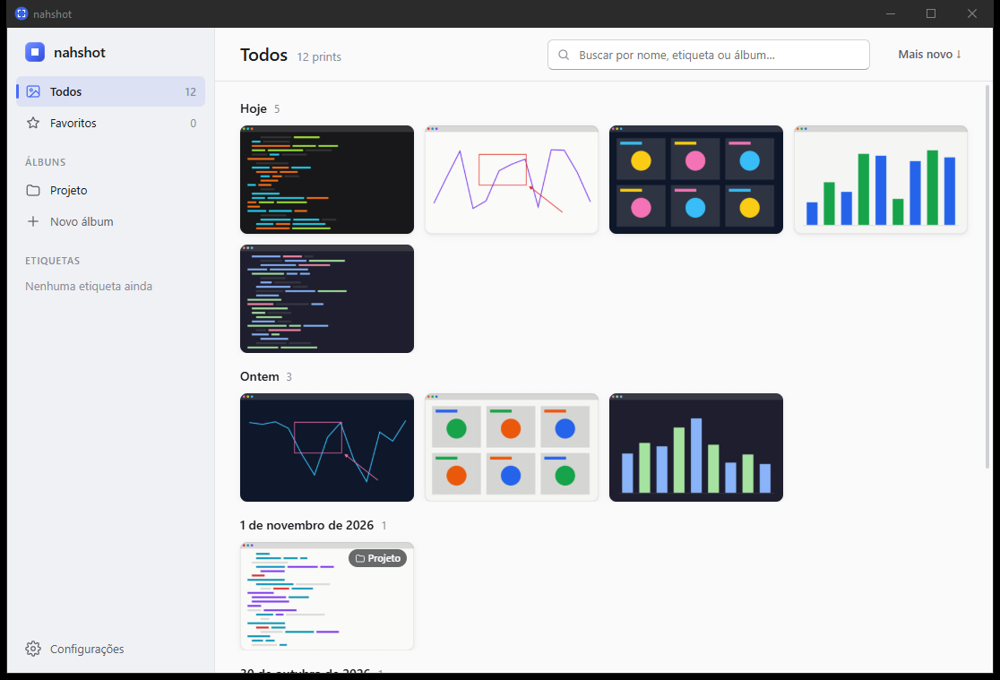

# nahshot

> A lightweight Lightshot-style screenshot tool for Windows, where every capture lands in an organized gallery. Rust + Tauri v2.

nahshot is a Windows screenshot app in the spirit of Lightshot: press Print Screen, select an area, annotate, then copy or save. The difference is that **no screenshot is ever lost**. Every confirmed capture is saved as a plain PNG in a folder organized by month and shows up in a gallery where you can browse by date, search, and organize with albums, tags and favorites. Organizing is optional: if you never touch anything, everything is still reachable by date. And it has to stay light, otherwise we'd just go back to Lightshot. That's why the capture overlay is native and the gallery only exists while it's open.



## Download

Grab the latest installer (`nahshot-<version>-windows-amd64-setup.exe`) or the standalone `.exe` from the [Releases](https://github.com/NathanGdS/nahshot/releases/latest) page. After that, nahshot keeps itself up to date (see [Auto-update](#auto-update)).

Requirements: Windows 10/11 64-bit with the WebView2 Runtime (bundled with Windows 11 and up-to-date Windows 10). No admin rights needed. The app interface is currently in Portuguese.

## Features

**Capture**
- Print Screen (optional: nahshot takes over the key and blocks the Snipping Tool) or an alternative hotkey (default `Ctrl+Shift+S`, configurable), plus the tray menu.
- The screen freezes and dims on **every monitor**. A selection can span monitors with different DPI scales, and the saved image is in physical pixels.
- Selection shows its size in pixels and can be moved/resized before confirming.
- **Full monitor in one go**: double-click an empty area or press **F** to select the whole monitor under the cursor. A hint at the top of the screen reminds you of this.
- Annotations: freehand pen, line, arrow, rectangle, ellipse, highlighter and text, with a color picker and undo (`Ctrl+Z`).
- **Tooltips** on every toolbar button, showing the tool name and its shortcut.
- Copy (`Ctrl+C`), Save as… (`Ctrl+S`) and Close (`Esc`). Any capture with a selected area is saved to the gallery, even if you only copy or close it.

**Gallery**
- Thumbnail grid grouped by day (Today, Yesterday, dates), newest first, with an option to reverse.
- Search by name, tag or album.
- Albums (real folders on disk), tags and favorites.
- Viewer with copy, show in Explorer, rename (renames the file), favorite, move to album, tag and delete (goes to the Recycle Bin).
- Multi-select (`Ctrl`/`Shift`+click) and drag onto an album.
- The folder is the source of truth: a PNG added or deleted in Explorer appears in or disappears from the gallery on its own.

**App**
- Lives in the system tray, starts with Windows (configurable) and runs as a single instance.
- Settings: screenshots folder (with an option to move existing ones), start with Windows, Print Screen as default, hotkey, light/dark theme, and update check.
- Auto-update from GitHub Releases, with signed installers.
- 100% local: your screenshots never leave your machine. The only network access is the update check against GitHub.

## Auto-update

On startup (release builds only) nahshot checks in the background for a new stable version. If one exists, it asks *Update now / Later*; on accept, it downloads the installer, closes, installs and reopens. You can also check manually in **Settings → Updates**.

Under the hood it uses `tauri-plugin-updater`: the app reads `latest.json` from the latest GitHub release, downloads the NSIS installer and verifies its minisign signature against the public key in `tauri.conf.json` before installing. Prereleases are never offered. Network failures only go to the log.

> v0.1.0 has no updater: if you have it, install the next version manually once.

## Architecture

A Cargo workspace with three crates:

| Crate | Role |
|---|---|
| `crates/nahshot-core` | UI-free domain: file names, screenshot library (PNG + SQLite via `rusqlite`), albums as folders, folder sync, file watcher (`notify`), thumbnail cache and screenshots-folder relocation. |
| `crates/nahshot-capture` | Native capture: grabs the monitors (`xcap`), draws the selection and annotation overlay (`winit` + `softbuffer` + `tiny-skia`, text via `fontdue`), global hotkey and a low-level keyboard hook for Print Screen. |
| `src-tauri` (package `nahshot`) | The Tauri v2 app: tray, settings, capture flow (PNG → library → clipboard / Save as), gallery commands, updater and windows. |

The gallery, settings and welcome UI lives in `ui/` (plain TypeScript + Vite, no framework).

**Why a native overlay?** The goal is for the overlay to appear in under ~150 ms after Print Screen and for the app to use under ~30 MB while idle. Spinning up a WebView2 on every capture is too slow, and keeping one pre-warmed would cost ~198 MB of RAM all the time (that's what the open gallery uses, summing the WebView2 processes). So the overlay is one `winit` window per monitor painting straight into a software buffer with `tiny-skia`, on its own thread that also serves the keyboard hook. WebView2 only exists while the gallery (or settings) is open. Close the window and the WebView2 processes exit, bringing the app back to its tray footprint.

## Measured footprint

Measured on the release build (`target\release\nahshot.exe`, built with `npm --prefix ui run tauri build`; the same binary the NSIS installer ships, run without installing), Windows 10 Pro with two 1920×1080 monitors, on 2026-11-04. Memory is the sum of the `nahshot` process **and all its descendants** (WebView2 included), measured with [`scripts/measure-idle.ps1`](scripts/measure-idle.ps1).

| State | Private bytes | Working set | Processes |
|---|---|---|---|
| Idle in tray, 60 s after boot | **23.2 MB** | 33.4 MB | 1 |
| After 5 captures | 24.2 MB | 37.1 MB | 1 |
| After opening and closing the gallery (+10 s) | 26.0 MB | 46.0 MB | 1 |
| *(reference) gallery open* | *197.7 MB* | *357.9 MB* | *7* |

Spec target: **< 30 MB idle**, children included. Met in every idle state; after closing the gallery no `msedgewebview2` process is left behind.

Latency from hotkey to visible overlay (`overlay_visible_ms`, from the hotkey event until the last monitor is presented, over 10 captures): **median 76 ms** (range 67–86 ms). Target: < 150 ms.

To measure again, with the app running:

```powershell
powershell -ExecutionPolicy Bypass -File scripts\measure-idle.ps1
# nahshot idle: private=23.2 MB, working_set=33.4 MB, processes=1
```

The script exits with code 1 if private bytes exceed 30 MB. To see latency, run the exe with `RUST_LOG=nahshot_capture=info` and redirect stderr.

## Building

Prerequisites: Windows 10/11 64-bit, stable Rust (MSVC toolchain), Node.js and the WebView2 Runtime.

```powershell
npm --prefix ui install
npm --prefix ui run tauri build    # same as `cargo tauri build`
```

The installer lands in `target\release\bundle\nsis\` and the executable in `target\release\nahshot.exe`. For development: `npm --prefix ui run tauri dev`.

Tests:

```powershell
cargo test --workspace
npm --prefix ui test
```

A plain `cargo build` or `cargo clippy` on a fresh clone needs `ui/dist`. Run `npm --prefix ui run build` first (the Tauri CLI does it for you).

The `Makefile` has shortcuts for all of this (`make dev`, `make build`, `make test`, `make lint`).

Local builds are not signed and don't need the updater key; signing only happens in CI.

## Releases

The version comes from the tag. To publish, on an up-to-date `main` with no pending changes:

```powershell
make release            # next patch (e.g. v0.1.0 → v0.1.1)
make release V=minor    # or V=major, V=1.2.0, V=1.2.0-beta.1
```

[`scripts/release.sh`](scripts/release.sh) checks the branch, pending changes and whether `main` is in sync with origin, shows the next tag and asks for confirmation (`--dry-run` only shows it). Pushing a `v*` tag triggers [`release.yml`](.github/workflows/release.yml), which builds the NSIS installer (tests already ran on `main`'s CI), signs it with the `TAURI_SIGNING_PRIVATE_KEY` secret, and publishes a GitHub release with `nahshot-<version>-windows-amd64-setup.exe`, its `.sig`, `latest.json` and the standalone `.exe`. Tags with a suffix (`-beta.1`) are published as prereleases and are not offered by the updater.

## Where screenshots live

By default in `%USERPROFILE%\Pictures\nahshot` (follows the Windows Pictures folder, including when it's on OneDrive), configurable:

```
nahshot\
  2026-11\
    2026-11-04_14-32-10.png
    2026-11-04_14-35-47.png
  2026-10\
    ...
  Álbuns\
    Project\
      2026-11-01_15-10-40.png
```

- They're regular PNGs, openable from Explorer even without the app. Uninstalling nahshot deletes nothing.
- An album is a subfolder of `Álbuns\`. A folder created there in Explorer becomes an album.
- Tags, favorites and capture dates live in a SQLite database in `%LOCALAPPDATA%\dev.nathangds.nahshot\`, alongside the thumbnail cache. Settings live in `%APPDATA%\dev.nathangds.nahshot\settings.json`.

## Roadmap

- Edit/re-annotate an old screenshot from the gallery.
- Cloud upload with a shareable link.
